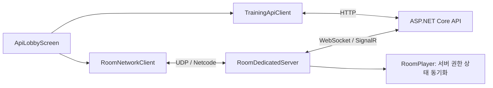

# Smart Training Platform

ASP.NET Core 백엔드와 연동해 로그인·로비·방 입장 및 실시간 멀티플레이를 처리하는 Unity 클라이언트와 전용 방 서버 프로젝트입니다.

현재는 **멀티 접속 및 방 관리 기반을 구현하는 단계**입니다. 플레이어 이동과 간단한 확인 화면은 네트워크 검증용이며, 훈련 장치·시나리오·결과 기록 콘텐츠는 아직 구현하지 않았습니다.

- 백엔드: [Smart Training Server](https://github.com/Jaehyung2028/Smart-Training-Server)
- 개발 범위: API 연동, 입장 예약 기반 접속, 전용 서버, 플레이어 동기화, 방장 관리 화면, 종료 및 재접속 처리

## 기술과 역할

| 기술 | 역할 |
|---|---|
| Unity `6000.4.7f1` / C# | 클라이언트 및 전용 서버 실행 |
| Netcode for GameObjects `2.12.0` | 플레이어 생성·소유권·상태 동기화 및 RPC |
| Unity Transport `2.6.0` | 클라이언트와 전용 서버 사이의 UDP 통신 |
| Input System `1.19.0` | 이동 입력 |
| UnityWebRequest | 로그인·로비·방 관리 API 요청 |
| SignalR 프로토콜 / WebSocket | 전용 서버의 ASP.NET 등록·입장 검증·강퇴 요청 수신 |
| URP `17.4.0` | 프로젝트 렌더링 환경 |

전용 서버의 `RoomHubConnection`은 SignalR JSON 프로토콜을 사용하는 소규모 WebSocket 구현입니다. 범용 SignalR SDK의 모든 기능을 구현한 것은 아닙니다.

## 구조와 설계



ASP.NET에서 사용자·입장 권한을 확인하고, 전용 서버에서 실제 연결과 플레이어 상태를 관리합니다. 클라이언트가 닉네임이나 방장 권한을 스스로 확정하지 않고 서버가 확인한 값으로 표시합니다.

방장은 전용 서버와 별개의 참가자 역할입니다. 방장 퇴장 시 남아 있는 참가자에게 권한을 위임하며, 전용 서버가 계속 실행되므로 다른 참가자의 연결을 유지합니다.

## 현재 구현 기능

- 닉네임 로그인, 토큰 갱신, 로비 생성·조회·입장·퇴장
- 콘텐츠 카탈로그 선택과 방 생성·목록·정원 표시
- 입장 예약 토큰을 이용한 전용 방 서버 접속과 실제 참가 확인
- 참가자별 플레이어 생성, 서버 확인 닉네임 표시, 소유자 이동 입력
- 서버 권한 이동 처리, 입력 제한, 위치 동기화, 늦게 들어온 참가자의 상태 수신
- 방장 표시·자동 위임·수동 위임·강퇴·신규 입장 잠금
- 직접 퇴장·로그아웃·Play 종료 시 접속 정리
- 연결 끊김 감지 후 로그인·로비 유지, 사용자 버튼으로 이전 방 재접속

입장 잠금은 기존 참가자를 내보내지 않고 새 입장을 차단합니다. 재접속은 새 입장이므로 잠금과 정원 검사를 다시 받습니다. 강퇴와 직접 퇴장에는 연결 복구 버튼을 표시하지 않습니다.

## 주요 파일과 함수

| 파일 | 주요 역할 |
|---|---|
| `Scripts/TrainingApiClient.cs` | 인증된 API 요청과 세션 갱신, `LogoutOnShutdown` |
| `Scripts/ApiLobbyScreen.cs` | 확인용 UI, `JoinRoom`, `HandleConnectionLost`, `ReconnectRoom` |
| `Scripts/RoomNetworkClient.cs` | 예약 검증·Netcode 연결, `Connect`, `Dispose` |
| `Scripts/RoomDedicatedServer.cs` | 입장 승인·ASP.NET 확인·플레이어 생성, `SynchronizeRoomMaster` |
| `Scripts/RoomHubConnection.cs` | 전용 서버의 RoomHub 연결과 요청·응답 처리 |
| `Scripts/RoomPlayer.cs` | 소유자 입력 RPC, 서버 권한 이동, 닉네임·방장·잠금 동기화 |
| `Scripts/EditorSessionCleanup.cs` | Play 종료 후 에디터에서 로그아웃 정리 요청 처리 |
| `Editor/RoomServerEndToEndTest.cs` | 실제 ASP.NET·별도 전용 서버·다중 클라이언트 통합 검증 |

위 경로의 기준 폴더는 `Assets/SmartTraining`입니다.

## 해결한 문제

### 에디터 종료 후 닉네임이 사용 중으로 남는 문제

Play를 종료하면 코루틴도 종료되어 일반 로그아웃 요청을 끝내지 못할 수 있었습니다. 에디터 실행 루프에서 종료 정리를 처리하고, 서버의 세션 만료 정리를 보완 경로로 사용했습니다.

### 실제 연결과 API 참가 상태의 불일치

API 예약 후 UDP 연결에 실패하면 예약만 남을 수 있습니다. 실패 시 예약·참가 정보를 정리하고, 전용 서버가 실제 연결을 확인한 뒤 플레이어를 생성하도록 연결 흐름을 나누었습니다.

### 연결 끊김과 재접속

전송 계층 heartbeat와 약 10초 무응답 기준을 설정했습니다. 연결 종료 후 이전 참가 상태를 확인하고 새 예약으로 재접속합니다. 기존 입장 토큰을 재사용하지 않으며, 자동 위임된 방장 권한도 되찾지 않습니다.

재접속은 자동 반복하지 않고 사용자가 **이전 방에 다시 접속** 버튼을 눌러 시도합니다. 마지막 참가자가 나가 방이 삭제된 경우에는 새 방을 선택해야 합니다.

## 실행 방법

1. Unity Hub에서 `6000.4.7f1`과 Windows Dedicated Server 빌드 모듈을 설치합니다.
2. 저장소를 Unity 프로젝트로 열고 패키지 가져오기가 완료될 때까지 기다립니다.
3. `Smart Training > Build Windows Room Server` 메뉴를 실행합니다.
4. 생성된 `Builds/RoomServer`의 전체 내용을 백엔드 저장소의 `Smart Training Server/RoomServer`에 복사합니다.
5. [백엔드 README](https://github.com/Jaehyung2028/Smart-Training-Server#실행-방법)에 따라 ASP.NET을 실행합니다.
6. `Assets/SmartTraining/Scenes/ApiLobby.unity`를 열고 Play합니다.
7. 화면의 서버 주소에 `http://localhost:5229` 또는 개발 인증서가 신뢰된 `https://localhost:7087`을 입력합니다.
8. 로그인 → 로비 생성/입장 → 콘텐츠 메타데이터 선택 → 방 생성 → 방 참가 순으로 진행합니다.

`Smart Training > Build Windows Test Client`로 별도 확인용 클라이언트를 빌드할 수 있습니다. 다른 닉네임으로 에디터와 실행 파일을 같은 방에 접속하면 두 참가자를 확인할 수 있습니다.

`Library`, `Temp`, `Logs`, `Builds`는 저장소에 포함하지 않습니다. Windows 로컬 개발 환경을 기준으로 검증했으며 외부 네트워크 배포는 별도 설정·검증이 필요합니다.

## 검증과 확인 방법

2026-10-13 기준 실제 ASP.NET HTTPS 서버와 별도 전용 서버를 사용하는 통합 검증에서 **114개 검증 항목**을 통과했습니다. 상태 대기·동기화 확인의 반복 항목을 포함한 수치이며, 114개의 독립 테스트 시나리오를 뜻하지 않습니다. Windows 전용 서버와 클라이언트 빌드도 통과했습니다.

검증 코드 `RoomServerEndToEndTest.Run`은 실행 중인 테스트용 API가 필요합니다. `SMART_TRAINING_TEST_URL`에 해당 주소를 지정하고 Unity의 `-executeMethod SmartTraining.Editor.RoomServerEndToEndTest.Run`으로 실행합니다. 테스트가 임시 사용자·로비·방을 생성하므로 개인 테스트 환경에서 실행합니다. 예:

```powershell
$env:SMART_TRAINING_TEST_URL = "https://localhost:7087"
& "<Unity.exe 경로>" -batchmode -nographics -projectPath "$PWD" -executeMethod SmartTraining.Editor.RoomServerEndToEndTest.Run -logFile "multiplayer-checks.log"
```

테스트 전 API 설정의 전용 서버 실행 경로가 준비되어 있어야 합니다. API 카탈로그는 저장소 기본 `sample-training` 항목을 사용합니다.

수동 확인 문서:

- [방장 표시·자동 위임](Assets/SmartTraining/STEP10-방장표시와자동위임.md)
- [수동 위임](Assets/SmartTraining/STEP11-방장수동위임.md)
- [강퇴](Assets/SmartTraining/STEP12-방장강퇴.md)
- [입장 잠금](Assets/SmartTraining/STEP13-방입장잠금.md)
- [연결 끊김·재접속](Assets/SmartTraining/STEP14-연결끊김과재접속.md)

## 앞으로 개발할 부분

- 실제 훈련 콘텐츠·시나리오와 장치 상호작용
- 사용자가 사용할 정식 UI와 씬 구성
- 훈련 결과 기록·조회 화면
- 외부 네트워크 배포 및 장애 상황 검증
- 실행 화면·데모 영상 추가

## 변경 기록과 업로드 방식

첫 업로드는 현재 멀티 접속 기반을 하나의 커밋으로 정리합니다. 이후에는 업로드 요청 시 변경 파일과 검증 결과를 확인하고 README를 갱신한 뒤 커밋·푸시합니다. 개발 중 변경을 자동으로 공개하지 않습니다. 서버 API가 바뀌면 두 저장소의 연결 방식과 실행 안내도 함께 확인합니다.
