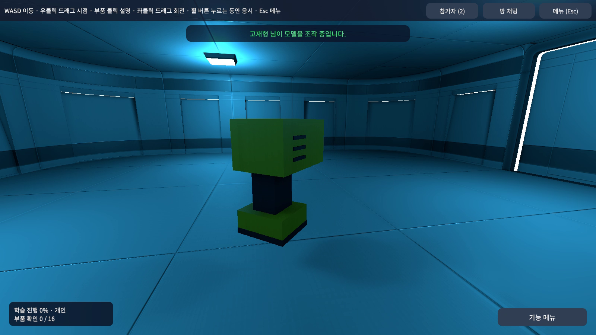
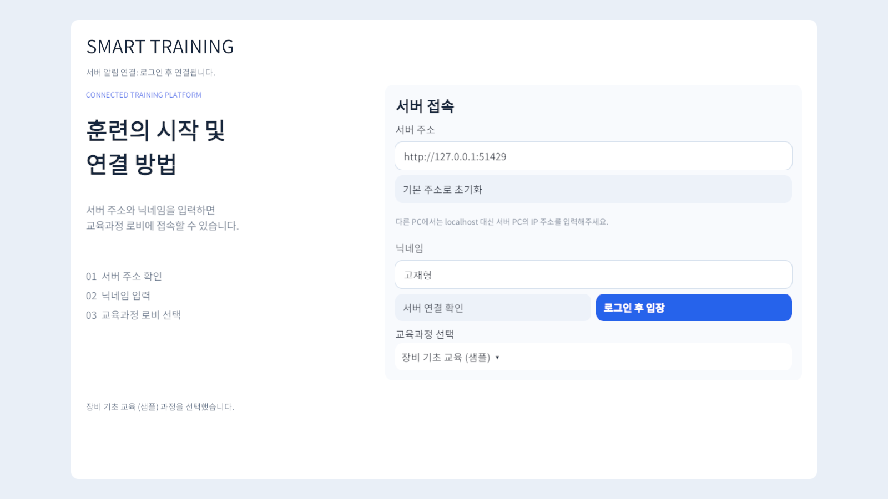
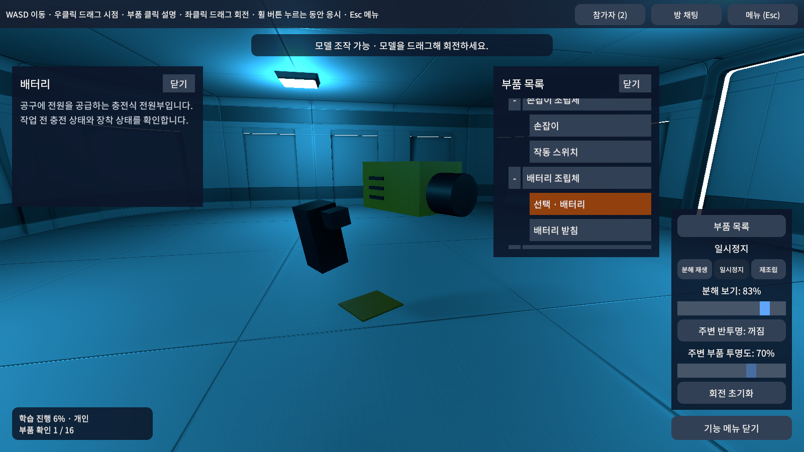
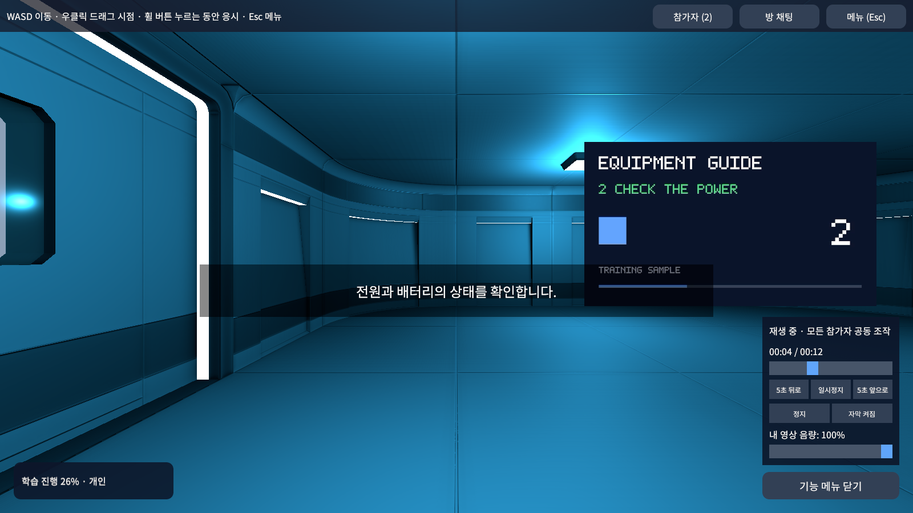
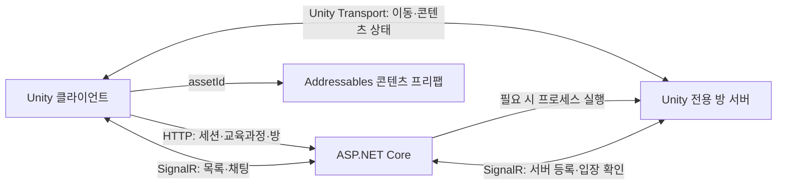

# Smart Training Platform

Unity 기반 멀티플레이 교육 플랫폼입니다. 참가자가 같은 3D 공간에서 장비를 관찰하고, 영상을 함께 시청하고, 역할을 나눠 공구 실습을 진행합니다. **Unity 클라이언트·전용 서버와 ASP.NET Core 백엔드를 연결하는 전체 흐름**을 구현했습니다.

- 작성자: 고재형
- [ASP.NET Core 서버 저장소](https://github.com/Jaehyung2028/Smart-Training-Server)
- [1분 시연 영상](docs/media/demo-60s.mp4) · [교육과정과 리소스 구성](Assets/SmartTraining/Documentation/Guides/CourseSamples.md)

## 사용 흐름

**서버 주소·닉네임·교육과정 선택 → 로그인 → 방 생성/참가 → 참가자 준비 → 방장 시작 → 콘텐츠 체험 → 대기실 복귀**

교육과정은 서버의 `catalog.json`에서 읽습니다. 방을 만들 때 트리 창에서 최하위 콘텐츠를 선택하며, 대기실에서 방장이 콘텐츠를 바꿀 수 있습니다. 다른 콘텐츠를 체험하기 위해 방을 다시 만들 필요가 없습니다.

## 구현 기능

| 영역 | 동작 |
|---|---|
| 접속·방 관리 | 토큰 세션, 자동 입장, 접속 예약/취소, 재접속 및 연결 종료 정리 |
| 방장·대기실 | 최초 방장, 자동/수동 위임, 강퇴, 입장 잠금, 이름·정원·비밀번호, 준비·시작·대기 복귀 |
| 멀티플레이 | 전용 서버 기반 이동·회전, Rigidbody 충돌, 플레이어 애니메이션, 이름표, 채팅·참가자 목록 |
| 모델 관찰 | 공유 회전과 조작권, 회전 초기화, 분해·재조립·재생 위치, 부품 트리·설명·하위 부품 강조, 주변 부품 투명도 |
| 공동 영상 | 모든 참가자의 재생·일시정지·정지·±5초·탐색, 재생 시점 동기화, 자막·개인 음량 |
| 시나리오 실습 | 개인별 공구 선택, 대상·공구·거리·역할 검사, 공구별 작업 모션, 공구 없는 확인 단계, 진행·결과 표시 |
| 협동 실습 | 역할별 작업, 담당자 표시, 이미 배정된 역할 선택 차단, 미배정 역할 추가 담당 |
| 공통 화면 | UGUI 프리팹, 콘텐츠별 기능 메뉴, 1인칭 카메라·응시 확대, 설정 저장/취소 |

### 교육과정 샘플

3개 교육과정에 **12개 실행 콘텐츠**를 연결했습니다. 분류 노드는 선택할 수 없고, 실행 노드는 `contentType`과 Addressables `assetId`로 리소스를 찾습니다.

| 교육과정 | 모델 | 영상 | 개인/공동 실습 | 역할 분담 실습 |
|---|---|---|---|---|
| 장비 기초 | 전동 드릴 | 장비 사용 순서 | 작업 전 공구 점검 | 장비 접점 정비 · 2역할 |
| 작업 안전 | 보호 장비 | 작업 전 안전 수칙 | 체결·타격 작업 | 방호 덮개 복구 · 2역할 |
| 비상 대응 | 소화기 | 비상 대응 순서 | 대피 전 안전 확인 | 비상 유도등 복구 · 4역할 |

실습에는 스패너·드라이버·망치·드릴·플라이어·파이프 렌치·톱·도끼와 공구 없는 확인 단계를 섞었습니다. 협동 콘텐츠의 2인/4인 표기는 역할 구성 기준이며, 한 사람이 미배정 역할을 여러 개 맡을 수 있습니다.

콘텐츠와 영상은 기능 설명을 위한 샘플입니다. 실제 산업 장비의 정밀한 작업 절차나 전문 교육 인증을 제공하는 자료는 아닙니다.

## 화면

### 교육과정 선택

### 방 내부와 준비 상태

### 모델과 부품 트리

### 공동 영상 시청

### 역할 분담과 공구 실습

## 기술과 구조

| 기술 | 담당 |
|---|---|
| Unity 6.4 / C# / URP | 3D 공간·플레이어·콘텐츠 화면 |
| Netcode for GameObjects / Unity Transport | 전용 서버, NetworkObject, NetworkTransform, NetworkRigidbody, 콘텐츠 상태 동기화 |
| Microsoft SignalR Client | ASP.NET과의 관리 이벤트·채팅·서버 등록 통신 |
| Addressables | 콘텐츠 프리팹과 추가 리소스 로딩 |
| UGUI / Input System | 로그인·방·콘텐츠 UI와 입력 |
| ASP.NET Core 8 | 사용자·교육과정·방 권한, 예약, 전용 서버 프로세스 관리 |

방장은 사용자 권한이며 네트워크 호스트는 전용 서버입니다. 방장 퇴장 시 다른 참가자가 호스트를 새로 열 필요가 없습니다. 로비는 ASP.NET의 데이터로 관리하고, 방 서버 프로세스만 요청에 맞춰 실행합니다.

### 주요 설계

- **예약과 접속 확정 분리:** API에서 자리를 예약한 뒤 전용 서버의 승인·접속 보고로 참가를 확정합니다. 실패·취소·만료 시 예약을 정리합니다.
- **이동의 서버 권한:** 서버가 Rigidbody 이동과 충돌을 처리하고 NetworkTransform/NetworkRigidbody로 전달합니다. 클라이언트는 입력을 보냅니다.
- **모델 조작권:** 조작할 때 소유권을 받고 NetworkTransform으로 회전을 동기화합니다. 조작 종료·이탈 후 서버가 권한을 회수합니다.
- **공유 상태와 개인 상태 분리:** 영상 재생 위치·실습 단계는 공동 상태이고, 음량·자막 표시·공구 선택·관찰 선택은 개인 상태입니다.
- **데이터 기반 콘텐츠:** 서버는 타입·리소스 ID를 전달하고 Unity는 대응 프리팹을 로드합니다. 공통 입력·카메라·UI와 콘텐츠 로직을 분리했습니다.
- **편집 가능한 배치:** 공통 맵·이름표·UI를 프리팹으로 관리하고 씬에 배치합니다. 동적 목록 행과 콘텐츠만 필요할 때 생성합니다.

## 주요 코드

| 위치 | 역할 |
|---|---|
| [Client/Controllers](Assets/SmartTraining/Scripts/Client/Controllers) | 로그인·교육과정·방 생성/입장/퇴장 흐름 |
| [TrainingApiClient.cs](Assets/SmartTraining/Scripts/Client/Api/TrainingApiClient.cs) | HTTP 요청과 응답 처리 |
| [Client/Networking](Assets/SmartTraining/Scripts/Client/Networking) | SignalR 연결과 Netcode 클라이언트 연결 |
| [RoomPlayer.cs](Assets/SmartTraining/Scripts/Gameplay/Room/RoomPlayer.cs) | 서버 이동·회전 및 플레이어 상태 |
| [Gameplay/Model](Assets/SmartTraining/Scripts/Gameplay/Model) | 공유 모델·부품·분해 동작 |
| [Gameplay/Video](Assets/SmartTraining/Scripts/Gameplay/Video) | 재생 상태·영상 출력·자막 |
| [Gameplay/Scenario](Assets/SmartTraining/Scripts/Gameplay/Scenario) | 역할·공구·대상·작업 진행 |
| [Servers](Assets/SmartTraining/Scripts/Servers) | 전용 서버의 콘텐츠 상태 처리 |
| [UI](Assets/SmartTraining/Scripts/UI) | UGUI 화면 및 콘텐츠별 패널 |

[문서 모음](Assets/SmartTraining/Documentation/README.md)에서 기능별 수정 위치를 확인할 수 있습니다.

## 실행 방법

1. Unity **6000.4.7f1**로 프로젝트를 열고 패키지와 에셋 가져오기가 끝날 때까지 기다립니다.
2. `Smart Training > Build > Build Windows Test Bundle`로 클라이언트와 전용 서버를 빌드합니다.
3. 생성된 `RoomServer` 폴더 전체를 ASP.NET의 `Room:ServerExecutablePath` 설정 경로에 배치합니다.
4. [서버 실행 안내](https://github.com/Jaehyung2028/Smart-Training-Server#실행-방법)에 따라 API를 실행합니다.
5. 클라이언트를 실행하거나 `Assets/SmartTraining/Scenes/ApiLobby.unity`를 Play합니다.
6. API 주소·닉네임·교육과정을 선택하고 방을 생성합니다. 다른 클라이언트가 참가해 준비하면 방장이 시작할 수 있습니다.

다른 PC에서는 API 서버의 LAN 주소를 사용하고 API TCP 포트와 방 서버 UDP 포트에 접근할 수 있어야 합니다. 실행 파일은 `_Data`·DLL을 포함한 폴더 전체가 필요합니다. 빌드 산출물은 Git에 포함하지 않습니다.

[빌드 안내](Assets/SmartTraining/Documentation/Guides/BUILD-TEST-BUNDLE.md)

## 현재 범위와 확장 계획

현재 사용자·방·훈련 진행은 메모리 중심입니다. 방을 떠나거나 서버가 종료된 뒤 학습 결과를 영구 보관하는 DB는 없습니다. 시청·관찰 진척은 클라이언트 보고를 사용합니다.

향후에는 실제 교육 자산과 상세 작업 절차, 계정·결과 DB, 기록 조회, 외부 배포 환경을 확장할 수 있습니다. 플레이어·공구·맵에는 외부 에셋이 포함되어 있으며, 프로젝트 로직과 교육 샘플 구성의 역할을 구분합니다.
