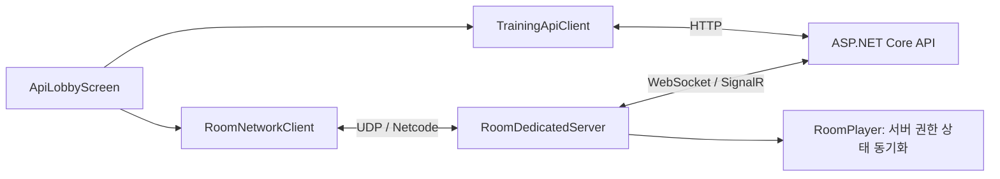
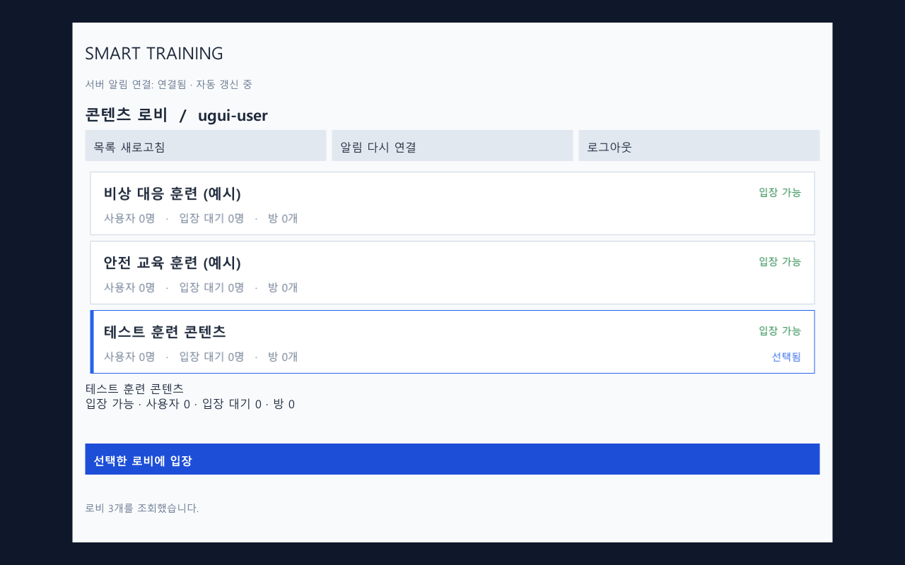
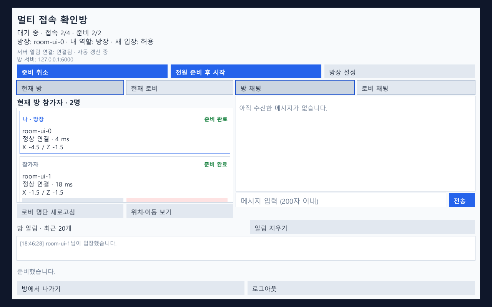

# Smart Training Platform

ASP.NET Core 백엔드와 연동해 로그인·로비·방 입장 및 실시간 멀티플레이를 처리하는 Unity 클라이언트와 전용 방 서버 프로젝트입니다.

멀티 접속·방 관리 기반에 Addressables 콘텐츠를 연결하고 있습니다. 현재 3D 모델 관찰, 공유 영상 재생, 공구로 볼트 2개를 푼 뒤 공구 없이 결과를 확인하는 공동 시나리오 실습 예시를 구현했습니다. 실제 교육용 정밀 공구 조작·장치 연동·결과 기록은 후속 개발 범위입니다.

- 백엔드: [Smart Training Server](https://github.com/Jaehyung2028/Smart-Training-Server)
- 개발 범위: API 연동, 입장 예약 기반 접속, 전용 서버, 플레이어 동기화, 방장 관리 화면, 종료 및 재접속 처리

## 기술과 역할

| 기술 | 역할 |
|---|---|
| Unity `6000.4.7f1` / C# | 클라이언트 및 전용 서버 실행 |
| Netcode for GameObjects `2.12.0` | 플레이어 생성·소유권·상태 동기화 및 RPC |
| Unity Transport `2.7.2` (embedded) | 클라이언트와 전용 서버 사이의 UDP 통신 |
| Input System `1.19.0` | 이동 입력 |
| UnityWebRequest | 로그인·로비·방 관리 API 요청 |
| Microsoft ASP.NET Core SignalR Client | 전용 서버 관리 통신, 로비 변경 알림과 채팅 |
| URP `17.4.0` | 프로젝트 렌더링 환경 |

`RoomHubConnection`은 Microsoft SignalR 클라이언트를 사용합니다. 연결·프로토콜·핑·요청 대응은 라이브러리에 맡기고, Unity 메인 스레드 이벤트 전달과 프로젝트의 요청 제한 시간을 연결합니다. HTTP·SignalR JSON은 `System.Text.Json`으로 처리합니다.

## 구조와 설계

ASP.NET에서 사용자·입장 권한을 확인하고, 전용 서버에서 실제 연결과 플레이어 상태를 관리합니다. 클라이언트가 닉네임이나 방장 권한을 스스로 확정하지 않고 서버가 확인한 값으로 표시합니다.

방장은 전용 서버와 별개의 참가자 역할입니다. 방장 퇴장 시 남아 있는 참가자에게 권한을 위임하며, 전용 서버가 계속 실행되므로 다른 참가자의 연결을 유지합니다.

## 현재 구현 기능

- 닉네임 로그인, 토큰 갱신, 종료·인증 만료 시 세션 정리
- 서버 `catalog.json` 기반 콘텐츠 로비 목록과 ASP.NET 직접 입장 처리
- 로비 안의 방 생성·검색·필터·정렬, 비밀번호와 정원 확인
- 접속 예약·검증·연결 확정, 입장 취소와 연결 실패 정리
- 플레이어 생성·이동 동기화, 연결 지연·준비 상태 표시
- 방장 자동·수동 위임, 강퇴, 입장 잠금, 방 설정·비밀번호 변경, 방 닫기
- 전원 준비 후 방장 시작, 대기 복귀와 준비 상태 초기화
- 로비·방 채팅, 참가자 목록, 방 목록과 운영 상태 자동 갱신
- 로비·방별 SignalR 그룹 전송과 재입장 시 이전 방 채팅 메시지 제외
- 연결 끊김 감지와 사용자 요청에 따른 이전 방 재접속
- 로그인·콘텐츠 로비·로비 내부·방 내부의 UGUI 화면과 공통 테마
- 씬 UI 편집·미리보기, 해상도 대응, 중복 입력 차단과 화면 전환 시 입력값 정리
- Windows Development 클라이언트·전용 서버 통합 빌드 메뉴

입장 잠금과 진행 중 상태에서는 신규 입장을 제한합니다. 재접속에도 현재 정원·비밀번호·입장 조건을 다시 확인하며, 강퇴와 직접 퇴장에는 연결 복구 대상을 남기지 않습니다.

Unity Transport는 프로젝트에 포함한 embedded 패키지를 사용합니다. 비정상 종료 뒤 수신 버퍼가 소진되는 문제의 수정 범위와 원본 라이선스는 [패치 안내](Packages/com.unity.transport/SMART-TRAINING-PATCH.md)와 패키지 내 `LICENSE.md`에서 확인할 수 있습니다.
방 만들기의 콘텐츠 선택 창은 카탈로그를 부모·자식 트리로 표시합니다. 가지를 펼치거나 접고 항목을 선택한 뒤 적용할 수 있으며, 취소하면 기존 선택을 유지합니다. 서버에는 루트 ID와 노드 ID를 함께 전달합니다.

## 주요 파일과 함수

| 파일 | 주요 역할 |
|---|---|
| `Scripts/Client/Api/TrainingApiClient.cs` | 인증된 API 요청과 세션 갱신, `LogoutOnShutdown` |
| `Scripts/Client/Controllers/ApiLobbyScreen.cs` | 확인용 UI, `JoinRoom`, `HandleConnectionLost`, `ReconnectRoom` |
| `Scripts/UI/Views/ContentTreePopup.cs` | 방 생성 콘텐츠 트리의 펼침·접기, 임시 선택과 적용·취소 |
| `Scripts/Client/Networking/RoomNetworkClient.cs` | 예약 검증·Netcode 연결, `Connect`, `Dispose` |
| `Scripts/Servers/RoomDedicatedServer.cs` | 입장 승인·ASP.NET 확인·플레이어 생성, `SynchronizeRoomMaster` |
| `Scripts/Client/Networking/RoomHubConnection.cs` | 전용 서버의 RoomHub 연결과 요청·응답 처리 |
| `Scripts/Gameplay/RoomPlayer.cs` | 소유자 입력 RPC, 서버 권한 이동, 닉네임·방장·잠금 동기화 |
| `Scripts/Diagnostics/EditorSessionCleanup.cs` | Play 종료 후 에디터에서 로그아웃 정리 요청 처리 |
| `Editor/Tests/Integration/RoomServerEndToEndTest.cs` | 실제 ASP.NET·별도 전용 서버·다중 클라이언트 통합 검증 |

위 경로의 기준 폴더는 `Assets/SmartTraining`입니다.

## 해결한 문제

### 에디터 종료 후 닉네임이 사용 중으로 남는 문제

Play를 종료하면 코루틴도 종료되어 일반 로그아웃 요청을 끝내지 못할 수 있었습니다. 에디터 실행 루프에서 종료 정리를 처리하고, 서버의 세션 만료 정리를 보완 경로로 사용했습니다.

### 실제 연결과 API 참가 상태의 불일치

API 예약 후 UDP 연결에 실패하면 예약만 남을 수 있습니다. 실패 시 예약·참가 정보를 정리하고, 전용 서버가 실제 연결을 확인한 뒤 플레이어를 생성하도록 연결 흐름을 나누었습니다.

### 연결 끊김과 재접속

전송 계층 heartbeat와 약 10초 무응답 기준을 설정했습니다. 연결 종료 후 이전 참가 상태를 확인하고 새 예약으로 재접속합니다. 기존 입장 토큰을 재사용하지 않으며, 자동 위임된 방장 권한도 되찾지 않습니다.

재접속은 자동 반복하지 않고 사용자가 **이전 방에 다시 접속** 버튼을 눌러 시도합니다. 마지막 참가자가 나가 방이 삭제된 경우에는 새 방을 선택해야 합니다.

## 실행 방법

1. Unity Hub에서 `6000.4.7f1`과 Windows Dedicated Server 빌드 모듈을 설치합니다.
2. 프로젝트를 열고 패키지 가져오기가 끝나면 `Smart Training > Build > Build Windows Test Bundle`을 실행합니다.
3. `Builds/TestBundles/날짜-고유번호`의 `RoomServer` 폴더 전체를 API 실행 폴더에 배치하거나 API의 실행 경로를 지정합니다. 방 서버의 실행 경로는 `Room:ServerExecutablePath`로 지정합니다.
4. [백엔드 실행 안내](https://github.com/Jaehyung2028/Smart-Training-Server#실행-방법)에 따라 ASP.NET을 실행합니다.
5. `Client/Smart Training Client.exe`를 실행하거나 `Assets/SmartTraining/Scenes/ApiLobby.unity`에서 Play합니다.
6. 서버 주소를 입력하고 로그인 → 콘텐츠 로비 선택 → 입장 → 방 생성 또는 선택 → 방 참가 순서로 확인합니다.

다른 PC에서는 localhost 대신 API 서버 PC의 주소를 사용합니다. 실행 파일 하나가 아니라 `_Data`와 DLL을 포함한 폴더 전체가 필요합니다. 클라이언트는 Development Build이며 정식 서비스 배포용 설정은 별도 작업 대상입니다.

[통합 빌드 안내](Assets/SmartTraining/Documentation/Guides/BUILD-TEST-BUNDLE.md) · [폴더 구조](Assets/SmartTraining/Documentation/README.md)

`Library`, `Temp`, `Logs`, `Builds`는 Git에서 제외합니다. 기존 개별 서버·클라이언트 빌드 메뉴도 유지합니다.

## 화면

## 앞으로 개발할 부분

- 실제 교육 자산을 활용한 시나리오 확장·정밀 공구 조작·훈련 장치 연동
- 사용자 피드백에 따른 UI 사용성 개선
- 훈련 결과 기록·조회 화면
- 외부 네트워크 배포 및 장애 상황 검증
- 실제 사용 흐름의 데모 영상 추가

## 변경 기록과 업로드 방식

첫 업로드는 현재 멀티 접속 기반을 하나의 커밋으로 정리합니다. 이후에는 업로드 요청 시 변경 파일과 검증 결과를 확인하고 README를 갱신한 뒤 커밋·푸시합니다. 개발 중 변경을 자동으로 공개하지 않습니다. 서버 API가 바뀌면 두 저장소의 연결 방식과 실행 안내도 함께 확인합니다.

- 방 생성 후 생성자의 초기 예약을 이어받아 자동 접속합니다. 접속 실패·취소 시 예약을 해제하고, 빈 방 정리는 서버가 담당합니다.

## 교육과정 샘플

장비 기초·작업 안전·비상 대응의 3개 교육과정에 모델·영상·실습 9개, 협동 실습 3개를 구성했습니다. 총 12개 최하위 콘텐츠가 각각 Addressables 프리팹에 연결됩니다. [콘텐츠 트리와 리소스 목록](Assets/SmartTraining/Documentation/Guides/CourseSamples.md)을 참고하세요.

## 학습 진행 표시

영상 시청과 지정 부품 관찰은 개인별로, 시나리오 실습은 공동으로 진행·완료 상태를 표시합니다. 콘텐츠 화면에서 본인 진행을 확인하고 대기실에서 참가자별 결과를 볼 수 있습니다. 대기 복귀에서는 유지하고 새 시작에서 초기화하며, 방 퇴장·방 서버 종료 이후의 영구 기록은 지원하지 않습니다. 개인 시청·관찰은 클라이언트 보고를 사용합니다. [완료 기준과 수정 위치](Assets/SmartTraining/Documentation/Guides/LearningProgress.md)를 참고하세요.
